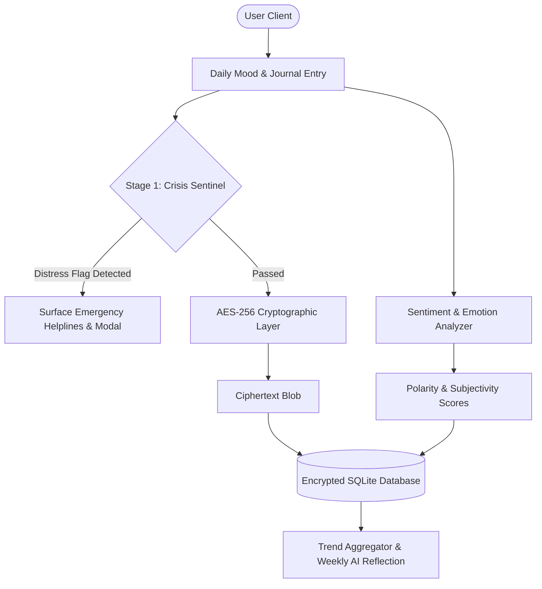
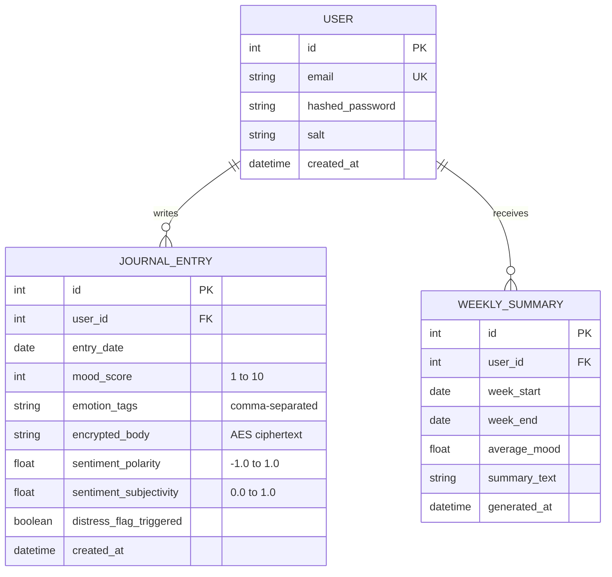

# Architecture Specification
## MindTrack: System Design & Technical Contracts

### 1. High-Level Architecture
MindTrack is structured for end-to-end privacy and deterministic user safety:
- **Presentation Tier**: React 18 SPA + Tailwind CSS + Lucide Icons + Recharts.
- **Application Tier**: FastAPI (Python 3.11) with modular routing (`/auth`, `/entries`, `/analytics`, `/summary`, `/safety`).
- **Cryptographic Engine**: Python `cryptography.fernet` (AES-CBC + HMAC-SHA256 authenticated encryption) managing database column-level encryption.
- **Sentiment & Safety Tier**: Dual-stage safety verification (Stage 1: Deterministic crisis keyword scanner; Stage 2: Sentiment scoring engine).

---

### 2. Database Schema (Entities & Relationships)

---

### 3. API Contract Specifications

| Method | Endpoint | Description | Request Body | Response (200 OK) | Error Codes |
|---|---|---|---|---|---|
| `POST` | `/api/v1/auth/register` | Register new user | `{email, password}` | `{user_id, email, access_token}` | 409 Conflict |
| `POST` | `/api/v1/entries` | Log encrypted daily entry | `{entry_date, mood_score, emotion_tags, journal_text}` | `{id, entry_date, sentiment_score, distress_flag}` | 422 Validation Error |
| `GET` | `/api/v1/entries` | Retrieve user entry history | Query: `start_date, end_date` | `[{id, entry_date, mood_score, emotions, decrypted_body, polarity}]` | 401 Unauthorized |
| `GET` | `/api/v1/analytics/trends` | 7-day and 30-day metrics | Query: `period="7d"|"30d"` | `{dates: [...], moods: [...], polarities: [...], top_emotions: [...]}` | 401 Unauthorized |
| `POST` | `/api/v1/summary/generate-weekly` | Generate AI weekly reflection | `{week_start_date}` | `{summary_text, key_highlights: [...], suggested_reflection}` | 404 No Data |
| `GET` | `/api/v1/safety/helplines` | Verified emergency helplines | None | `{country: "India", helplines: [{name, number, hours, description}]}` | 200 OK |

---

### 4. Safety Sentinel Protocol Specification
The Safety Sentinel evaluates all user journal text prior to storage using a verified multi-pattern dictionary covering acute self-harm, severe crisis, and suicidal ideation markers.
- If triggered:
  1. `distress_flag_triggered` is set to `true`.
  2. The response immediately returns a high-priority safety payload:
     `{ distress_detected: true, helplines: [...] }`
  3. The client application renders an unclosable or prominent Emergency Support Banner offering direct one-tap calling to Tele-MANAS (14416) and Vandrevala Foundation (+91 9999 666 555).
